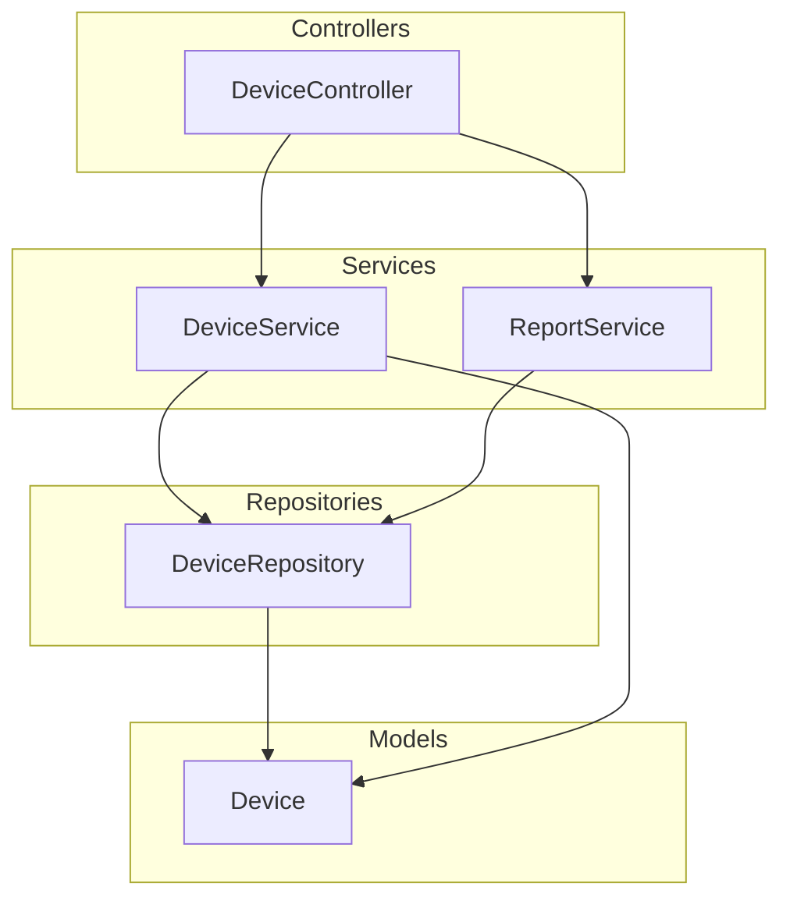

# Demo #3 — Beklenen Çıktı (Eğitmen Cevap Anahtarı)

Bu dosya, Copilot'un `Demo3-MindMap/src` klasörünü analiz ettiğinde üretmesi **beklenen**
mimari görünümü ve tespit etmesi beklenen teknik borç alanlarını içerir. Katılımcılara
önceden gösterilmez; Copilot çıktısını karşılaştırmak için kullanılır.

## Prompt

```
klasöründeki projenin katmanlı mimarisini çıkar. Katmanları, sınıfları ve bağımlılıkları bir mindmap markdown olarak üret. Ardından technical debt ve riskli alanları (yüksek coupling, katman atlama, thread-safety, eksik validasyon) madde madde listele.
```

## Beklenen Mimari (Mermaid)



## Beklenen Teknik Borç Tespitleri

| # | Alan | Sorun | Öneri |
|---|------|-------|-------|
| 1 | DeviceController | Dependency Injection yok; bağımlılıklar `new` ile elle oluşturuluyor → yüksek coupling, test edilemez | Constructor injection + arayüz (`IDeviceService`) |
| 2 | ReportService | Kendi katmanı yerine doğrudan `DeviceRepository`'ye bağlı → katman atlama | `DeviceService` üzerinden erişim |
| 3 | DeviceRepository | Bellek-içi `static` liste; thread-safe değil; kalıcılık yok | Gerçek veri erişimi + eşzamanlılık koruması |
| 4 | DeviceRepository | Her serviste ayrı `new` → paylaşılmayan durum riski | Singleton/DI ile tek örnek |
| 5 | DeviceService.AddDevice | İş kuralı validasyonu yok | Guard clause + doğrulama |
| 6 | DeviceRepository.Insert | Id çakışması / duplicate kontrolü yok | Benzersizlik kontrolü |
| 7 | Model | `Device` alanları nullable/`required` işaretlenmemiş | `required` veya nullable annotation |

**Vurgu:** Copilot bu haritayı ve borç listesini dakikalar içinde çıkarır — onboarding ve
mimari gözden geçirme için güçlü bir başlangıç. Ancak tespitleri ekip birlikte teyit etmelidir.
